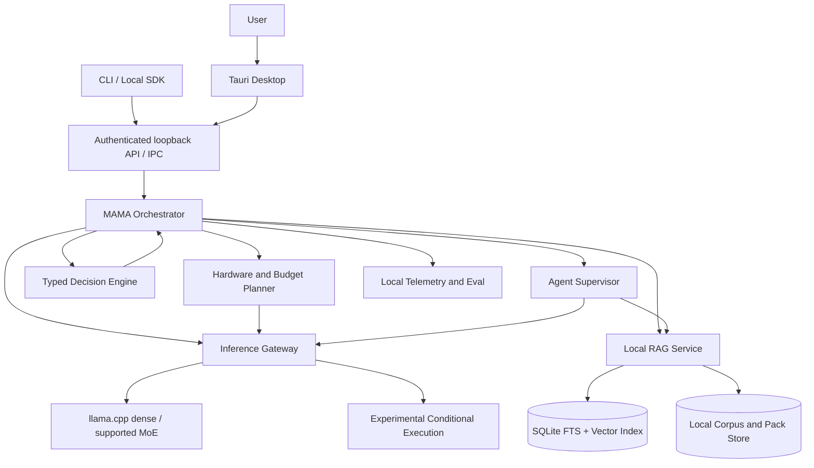

# System Architecture
## Context

## Process boundaries
Desktop UI unprivileged. Rust daemon owns authenticated API, model execution, document index, job queue and audit log. Native inference library executes in dedicated worker process where isolation is practical. Agent tools run sandboxed with explicit user grants. Research tooling not installed on user machines.
## Contracts
`/health`, `/v1/capabilities`, `/v1/hardware`, `/v1/budgets`, `/v1/models`, `/v1/knowledge`, `/v1/chat/completions`, `/v1/agents/runs`, `/v1/evals/runs`, `/v1/metrics`. Versioned JSON schemas and SSE events; CLI and desktop use same API. Backend binds 127.0.0.1 by default; optional Unix domain socket/named pipe.
## Storage
SQLite WAL for metadata, document and job state; FTS5 for lexical search; embedded vector index; content-addressed blob store for imported documents; separate immutable model cache and bounded scratch/offload space; append-only audit stream with retention policy.
## Failure domains
UI crash does not kill daemon; model worker crash restarts without losing indexing jobs; corrupted index triggers rebuild; low disk prevents downloads; low RAM triggers cancellation or compatible fallback; disconnected external provider never blocks offline decisions.
